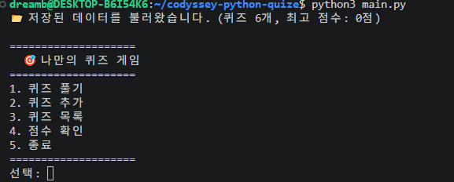
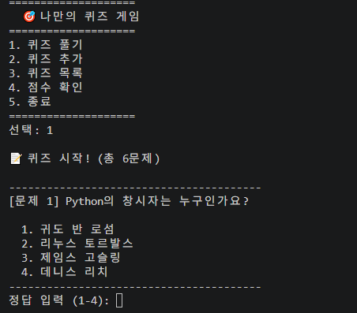
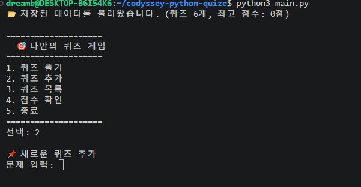
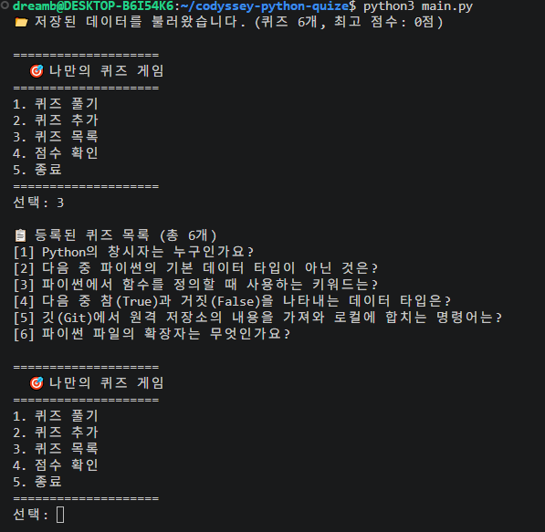
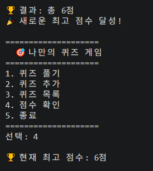
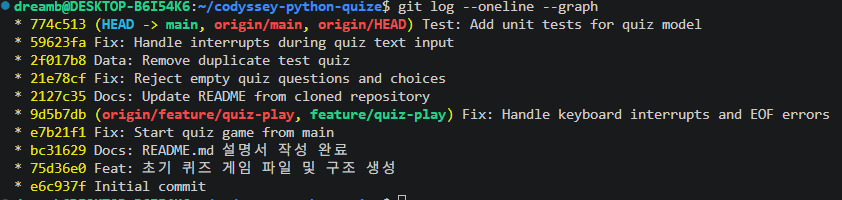
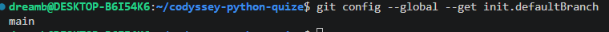
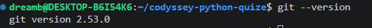
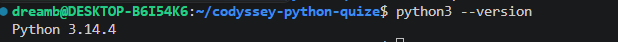

# 나만의 파이썬 퀴즈 게임
### Python Quiz Game

## 1. 프로젝트 소개

Python을 이용하여 터미널에서 실행할 수 있는 콘솔 기반 퀴즈 게임을 만들었습니다.

사용자는 퀴즈를 풀고, 새로운 퀴즈를 추가하고, 등록된 퀴즈 목록과 최고 점수를 확인할 수 있습니다.

퀴즈 데이터와 최고 점수는 JSON 파일에 저장되므로 프로그램을 종료한 후 다시 실행해도 데이터가 유지됩니다.

## 2. 개발 목적 및 학습 내용

이번 프로젝트를 통해 다음 내용을 학습하고 적용했습니다.

- Python의 기본 문법과 자료형
- 클래스와 객체를 이용한 객체 지향 프로그래밍
- 함수와 메서드를 이용한 기능 분리
- 사용자 입력값 검증
- JSON 파일을 이용한 데이터 저장 및 불러오기
- 예외 처리
- Git을 이용한 버전 관리
- GitHub 원격 저장소 활용
- unittest를 이용한 단위 테스트

## 3. 실행 방법

Python 3.10 이상이 설치된 환경에서 프로젝트 폴더로 이동한 후 다음 명령어를 실행합니다.

```bash
python main.py
```

## 4. 주요 기능

1. **퀴즈 풀기**: 등록된 퀴즈를 풀고 정답 여부를 확인합니다.
2. **퀴즈 추가**: 새로운 문제와 네 개의 선택지, 정답을 입력합니다.
3. **퀴즈 목록**: 등록된 퀴즈를 확인합니다.
4. **점수 확인**: 저장된 최고 점수를 확인합니다.
5. **종료**: 프로그램을 종료합니다.

### 프로그램 실행 화면



### 퀴즈 진행 화면



### 퀴즈 추가 화면



### 퀴즈 목록 화면



### 점수 확인 화면



## 5. 파일 구성

| 파일 및 폴더 | 역할 |
|---|---|
| `main.py` | 프로그램 실행 시작점 |
| `game.py` | 게임 진행, 메뉴, 입력 검증 및 데이터 관리 |
| `quiz.py` | 퀴즈 클래스 정의 |
| `state.json` | 퀴즈 데이터와 최고 점수 저장 |
| `test_quiz.py` | 퀴즈 클래스의 기능 테스트 |
| `docs/screenshots/` | 프로젝트 실행 및 작업 증거 화면 |

## 6. 클래스 설계 및 역할 분리

### Quiz 클래스 (`quiz.py`)

하나의 퀴즈에 필요한 데이터를 관리합니다.

- `__init__()`: 문제, 선택지, 정답을 초기화합니다.
- `display()`: 문제와 선택지를 화면에 출력합니다.
- `check_answer()`: 입력한 답이 정답인지 확인합니다.
- `to_dict()`: 퀴즈 객체를 JSON 저장에 사용할 수 있는 딕셔너리로 변환합니다.

### QuizGame 클래스 (`game.py`)

전체 게임의 진행과 데이터를 관리합니다.

- `load_data()`: 저장된 JSON 데이터를 불러옵니다.
- `save_data()`: 퀴즈와 최고 점수를 JSON 파일에 저장합니다.
- `load_default_quizzes()`: 저장된 데이터가 없을 때 기본 퀴즈를 생성합니다.
- `get_validated_input()`: 숫자 입력과 허용 범위를 검사합니다.
- `get_text_input()`: 문자열 입력을 처리합니다.
- `play_quiz()`: 퀴즈를 진행하고 점수를 계산합니다.
- `add_quiz()`: 새로운 퀴즈를 추가합니다.
- `show_quizzes()`: 퀴즈 목록을 출력합니다.
- `show_score()`: 최고 점수를 출력합니다.
- `run()`: 메뉴를 반복해서 보여주고 사용자의 선택에 따라 기능을 실행합니다.

퀴즈 하나의 데이터와 기능은 `Quiz` 클래스가 담당하고, 전체 게임의 흐름과 데이터 관리는 `QuizGame` 클래스가 담당하도록 분리했습니다.

이렇게 역할을 나누면 코드의 구조를 이해하기 쉽고 기능을 수정하거나 추가하기 편리합니다.

## 7. 사용자 입력 검증 및 예외 처리

사용자가 잘못된 값을 입력했을 때 프로그램이 바로 종료되지 않도록 입력값을 검사합니다.

- 숫자가 아닌 값을 입력하면 다시 입력하도록 안내합니다.
- 허용된 범위를 벗어난 숫자를 입력하면 다시 입력하도록 안내합니다.
- 문제나 선택지를 비워 두면 다시 입력하도록 처리합니다.
- `KeyboardInterrupt`와 `EOFError`가 발생하면 저장을 시도한 후 프로그램을 종료합니다.

입력값 검증은 `game.py`에서 처리하고, 실제 정답 확인은 `Quiz` 클래스의 `check_answer()`에서 처리합니다.

## 8. JSON 데이터 저장

퀴즈 데이터와 최고 점수는 `state.json` 파일에 저장합니다.

JSON은 사람이 읽기 쉬운 데이터 형식이며, Python의 딕셔너리와 리스트를 이용해 데이터를 구성할 수 있습니다.

저장 데이터의 기본 구조는 다음과 같습니다.

```json
{
    "quizzes": [
        {
            "question": "파이썬 파일의 확장자는 무엇인가요?",
            "choices": [
                ".py",
                ".exe",
                ".txt",
                ".html"
            ],
            "answer": 1
        }
    ],
    "best_score": 6
}
```

- `quizzes`: 퀴즈 데이터를 저장하는 리스트입니다.
- `question`: 문제 내용입니다.
- `choices`: 네 개의 선택지를 저장합니다.
- `answer`: 정답 번호입니다.
- `best_score`: 최고 점수입니다.

프로그램을 시작하면 `load_data()`가 JSON 파일을 읽고 퀴즈 객체를 생성합니다.

퀴즈를 추가하거나 최고 점수가 갱신되면 `save_data()`를 통해 변경 내용을 저장합니다.

파일을 읽고 쓸 때는 `with open()`을 사용하고, 한글이 깨지지 않도록 `encoding="utf-8"`을 지정했습니다.

### 데이터 저장 방식의 한계와 개선점

현재는 JSON 파일에 데이터를 직접 저장하는 방식입니다.

데이터가 많아지거나 여러 사용자가 동시에 데이터를 변경하는 상황에서는 데이터베이스를 사용하는 것이 더 적합합니다.

또한 현재 저장 방식은 별도의 백업 파일을 만들지 않습니다. 데이터 파일이 손상되면 기본 퀴즈 데이터로 복구하도록 처리했지만, 기존에 저장된 사용자 데이터까지 자동으로 복원하지는 못합니다.

## 9. 기본 퀴즈 데이터

처음 실행하거나 저장 데이터가 없는 경우 `load_default_quizzes()`를 통해 기본 퀴즈 5개를 생성합니다.

기본 퀴즈는 Python과 Git의 기초 내용을 확인할 수 있도록 구성했습니다.

사용자는 기본 퀴즈 외에도 직접 문제를 추가할 수 있습니다.

## 10. 단위 테스트

`test_quiz.py`에서 Python의 `unittest` 모듈을 사용하여 `Quiz` 클래스의 기능을 테스트합니다.

테스트 항목은 다음과 같습니다.

- 정답을 입력했을 때 `True`를 반환하는지 확인
- 오답을 입력했을 때 `False`를 반환하는지 확인
- `to_dict()`가 올바른 딕셔너리를 반환하는지 확인

테스트 실행 명령어:

```bash
python -m unittest test_quiz.py
```

## 11. 기능 수정 및 확장 시 파일별 역할

| 변경하려는 기능 | 관련 파일 |
|---|---|
| 퀴즈 데이터 구조 변경 | `quiz.py` |
| 정답 판정 방식 변경 | `quiz.py` |
| 퀴즈 진행 방식 변경 | `game.py` |
| 메뉴 기능 추가 | `game.py` |
| 입력 검증 방식 변경 | `game.py` |
| 데이터 저장 구조 변경 | `game.py`, `state.json` |
| 프로그램 실행 방식 변경 | `main.py` |
| 테스트 항목 추가 | `test_quiz.py` |

기능별 역할을 나누어 두었기 때문에 변경이 필요한 부분을 찾아 수정하기 쉽도록 구성했습니다.

## 12. Git 및 GitHub 버전 관리

Git을 사용하여 프로젝트의 변경 사항을 기록하고 관리했습니다.

GitHub 원격 저장소:

https://github.com/dreamb-lab/codyssey-python-quize

주요 Git 명령어:

```bash
git init
git add .
git commit -m "커밋 메시지"
git branch
git checkout -b 브랜치명
git push
git pull
git log --oneline
```

프로젝트를 진행하면서 기능 추가, 오류 수정, 데이터 관리, 테스트 작성 및 문서 수정 등의 작업을 커밋으로 기록했습니다.

### Git 커밋 기록



### Git 설정 화면



### Git 버전 확인



### Python 버전 확인



## 13. 프로젝트를 통해 배운 점

이번 프로젝트를 통해 단순히 Python 문법을 사용하는 것에서 나아가 여러 기능을 하나의 프로그램으로 연결하는 과정을 경험했습니다.

특히 클래스를 이용한 역할 분리, 사용자 입력 검증, JSON 파일을 이용한 데이터 저장, 예외 처리 및 단위 테스트의 필요성을 이해할 수 있었습니다.

또한 Git을 이용해 작업 과정을 기록하고 GitHub 원격 저장소에 프로젝트를 관리하는 방법을 익혔습니다.